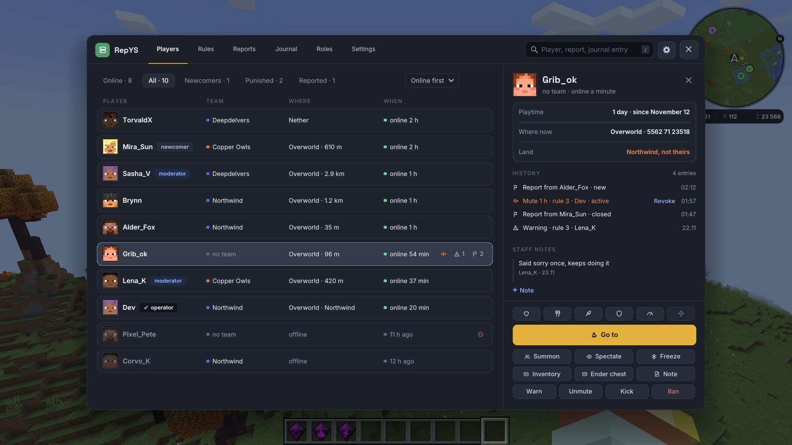

# RYSHelm

*Русская версия ниже: [по-русски](#по-русски).*



**The Server window for those who run a server.** Players, roles and permissions, punishments, reports and a journal in one window. The main actions are also available as commands.

## Features

- a player list with a player card and staff actions
- three roles and a permissions table; LuckPerms decides permissions if it is installed
- punishments with durations and a ladder
- reports with the location, chat and the offender's history
- a journal of staff actions
- rules on join
- kits, anti-spam, a whitelist and an "away" status

The main actions are available as `/rys admin` commands, players report with `/report`.

## Requirements

- Minecraft 1.21.1, NeoForge 21.1.x, client and server.
- No other mods required.
- Languages: English and Russian.

## Download and help

- Download: [CurseForge](https://www.curseforge.com/minecraft/mc-mods/ryshelm).
- Help, ideas and questions: [Discord](https://discord.gg/Tqgy7acmyd).
- Bugs: [GitHub Issues](https://github.com/MityaKr/RYSHelm/issues).

## The RYS family

RYSHelm is part of the RYS family of mods: one style, shared themes and settings. Each mod works on its own, and together they complement each other.

- [RYSQuests](https://www.curseforge.com/minecraft/mc-mods/rysquests), a quest book with guides and a shop.
- [RYSIndex](https://www.curseforge.com/minecraft/mc-mods/rysindex), a recipe viewer with crafting trees.
- [RYSMap](https://www.curseforge.com/minecraft/mc-mods/rysmap), a world map and minimap.
- [RYSClaims](https://www.curseforge.com/minecraft/mc-mods/rysclaims), chunk land claims.
- [RYSTeams](https://www.curseforge.com/minecraft/mc-mods/rysteams), player teams with roles and alliances.

## Building from source

You need Java 21. The build takes the family's shared code from the [RYSCore](https://github.com/MityaKr/RYSCore) repository, which must sit next to this one and be published to its local `repo/` folder first:

```
git clone https://github.com/MityaKr/RYSCore
git clone https://github.com/MityaKr/RYSHelm
cd RYSCore && ./gradlew publish
cd ../RYSHelm && ./gradlew build
```

The jar is in `build/libs`.

## License

The code is under [MPL-2.0](LICENSE). The graphics and the RYS name remain with the author, see [NOTICE.md](NOTICE.md). You can include the mod in any modpack without asking for permission.

Author: MityaYS, RepkaWorks.

---

## По-русски

**Окно «Сервер» для тех, кто ведёт сервер.** Игроки, роли и права, наказания, жалобы и журнал собраны в одном окне. Основные действия есть и командами.

### Возможности

- список игроков с карточкой и действиями персонала
- три роли и таблица прав; если стоит LuckPerms, права решает он
- наказания со сроками и лестницей
- жалобы с местом, чатом и историей нарушителя
- журнал действий персонала
- правила при входе
- наборы, антиспам, белый список и статус «отошёл»

Основные действия есть командами `/rys admin`, игроки жалуются командой `/report`.

### Требования

- Minecraft 1.21.1, NeoForge 21.1.x, клиент и сервер.
- Других модов не требует.
- Языки: русский и английский.

### Скачать и спросить

- Скачать: [CurseForge](https://www.curseforge.com/minecraft/mc-mods/ryshelm).
- Помощь, идеи и вопросы: [Discord](https://discord.gg/Tqgy7acmyd).
- Баги: [GitHub Issues](https://github.com/MityaKr/RYSHelm/issues).

### Семья RYS

RYSHelm входит в семью модов RYS: один стиль, общие темы и настройки. Каждый мод работает сам по себе, а вместе они дополняют друг друга.

- [RYSQuests](https://www.curseforge.com/minecraft/mc-mods/rysquests), книга квестов с гайдами и магазином.
- [RYSIndex](https://www.curseforge.com/minecraft/mc-mods/rysindex), справочник рецептов с деревом крафта.
- [RYSMap](https://www.curseforge.com/minecraft/mc-mods/rysmap), карта мира и миникарта.
- [RYSClaims](https://www.curseforge.com/minecraft/mc-mods/rysclaims), приват земли по чанкам.
- [RYSTeams](https://www.curseforge.com/minecraft/mc-mods/rysteams), команды игроков с ролями и союзами.

### Сборка из исходников

Нужна Java 21. Общий код семьи сборка берёт из репозитория [RYSCore](https://github.com/MityaKr/RYSCore): он должен лежать рядом с этим и сначала выложиться в свою папку `repo/` командой `gradlew publish` (команды выше). Готовый jar лежит в `build/libs`.

### Лицензия

Код под [MPL-2.0](LICENSE), графика и имя RYS остаются за автором, подробности в [NOTICE.md](NOTICE.md). Мод можно включать в любую сборку без отдельного разрешения.

Автор: MityaYS, RepkaWorks.
